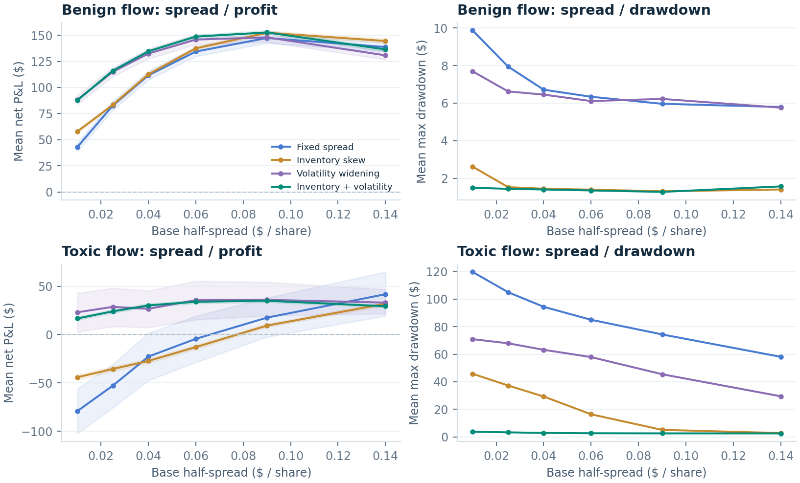

# QuoteLab

**When do tighter quotes earn more, and when do informed traders erase the edge?**

QuoteLab is an event-driven research laboratory for synthetic single-asset market making.
It compares a fixed-spread market maker with inventory skew, volatility widening, and
their combination. Identical exogenous market tapes make policy comparisons paired;
every session closes inventory at a cost and reconciles cash to an exact P&L decomposition.

**Delivered study:** 12,580 sessions, six main market regimes, 30 development seeds and
40 held-out seeds per regime, six base half-spreads, and separate toxicity/refresh sweeps.
The core has 33 automated tests. These are synthetic experiments, not a real-market backtest.



## Start here

1. Read `reports/QuoteLab_Research_Memo.pdf` for the question, results, and limitations.
2. Open `reports/QuoteLab_Dashboard.html` in any modern browser. This saved explorer
   needs no server, network, account, or additional packages.
3. Follow the commands below to change assumptions and rerun the study.
4. Work through `docs/INTERVIEW_GUIDE.md` and audit one trade in a CSV ledger.

## Run locally

Requires Python 3.10 or newer. From the extracted `quotelab` directory:

```bash
python3 -m venv .venv
source .venv/bin/activate
python -m pip install -e .
python -m unittest discover -s tests -v
python -m quotelab dashboard
```

On Windows use `python -m venv .venv` and `.venv\Scripts\Activate.ps1` instead of `source`.
Then open **http://127.0.0.1:8765**. The dashboard can compare all four policies on a
new shared tape while changing the spread, risk aversion, volatility buffer, inventory
limit, fee, or quote-refresh interval. Only the single-path tab changes when you run
new settings; the evidence tabs retain the bundled research dataset.

One session, including a path and trade ledger:

```bash
python -m quotelab simulate --scenario toxic --policy adaptive --seed 20000
python -m quotelab simulate --scenario jump_shock --policy fixed --refresh 8
```

Reproduce the complete experiments (about one minute on the development machine;
runtime depends on hardware):

```bash
python -m quotelab research --workers 4
python -m pip install -e '.[report]'
python scripts/build_report.py
```

`--workers 1` is the serial default and produces the same ordered rows. Versions used
in the delivered run are in `results/manifest.json` and `requirements-reproduction.txt`.
Numerical libraries can change random sampling or last-digit floating-point results
between versions. The manifest records seed ranges, parameters, versions, session
counts, and the maximum accounting residual. The PDF and figures are built from the
CSV results, so changing the study also changes the report's data.

## What the study found

At the reference base half-spread of $0.04, inventory skew reduced average absolute
inventory in the toxic regime from 15.23 to 1.44 shares, but its mean net P&L was
-$27.28. Adding volatility widening produced mean P&L of $30.17 and mean maximum
drawdown of $2.82 in that regime.

The interpretation matters: widening changes the actual spread. After each policy's
base width was selected on development seeds, the combined policy's toxic-regime
P&L advantage over the tuned fixed baseline had a paired 95% interval containing
zero. Its inventory and drawdown remained much lower. The combined policy also
underperformed the tuned fixed baseline in mean P&L in some regimes.

Refresh stress provides a failure case: in toxic flow, the combined policy's mean P&L
fell from $29.67 with one-step refresh to -$55.37 with eight-step refresh. A reactive
volatility estimate cannot guarantee protection against fresh jumps or stale quotes.

## Design

| Component | Responsibility |
| --- | --- |
| `config.py` | Units, validation, policy defaults, six synthetic regimes |
| `market.py` | Arithmetic jump-diffusion price path; ordinary/informed arrivals; immutable shared tape |
| `strategy.py` | Causal quotes using current observed mid, own inventory, and EWMA variance |
| `engine.py` | Ordered fills, per-fill risk limits, paid liquidation, markouts, accounting identity |
| `metrics.py` | Seed-level bootstrap intervals and paired policy effects |
| `experiment.py` | Disjoint selection/evaluation seeds, grids, feature ablations, sensitivity sweeps |
| `server.py` | Loopback-only dashboard and bounded simulation endpoint |
| `scripts/build_report.py` | Reproducible figures, memo, and offline interactive explorer |

## Model in one minute

At step `t`, a policy observes `mid[t]`, its inventory, and past returns. It submits
or refreshes a bid and ask. The efficient price then moves to `mid[t+1]`, and an
independently generated sequence of potential orders arrives.

Ordinary traders decide using the prior public midpoint `mid[t]` plus an exponential
willingness-to-pay depth. Informed traders see the new efficient price and trade
only when a standing quote offers them more than their minimum edge. Quotes
auto-refill one share at a time at unchanged prices until the next refresh; the
inventory cap is checked at every fill. No queue position, competing makers,
price impact, or network cancellation dynamics are modeled.

The dealer's signed fill quantity is `dq` (+1 buy, -1 sell), price is `p`, and the
quote was formed at reference midpoint `m_ref`:

```text
quote edge       = dq * (m_ref - p)
fill repricing   = dq * (m_exec - m_ref)
inventory P&L    = q_before_step * (m_exec - m_previous)
net P&L          = sum(quote edge + fill repricing + inventory P&L)
                   - execution fees - terminal liquidation costs
```

Quote edge includes inventory skew and ticks. Fill repricing can be positive or
negative; it is not universally a loss. `informed_execution_pnl` separately isolates
the net execution edge of filled informed orders, which is negative by construction.
Neither repricing nor markouts are subtracted from P&L a second time.

## Research protocol

- Main grid: 6 regimes x 70 seeds x 6 base half-spreads x 4 policies = **10,080** sessions.
- Toxicity sweep: 4 informed-arrival fractions x 25 seeds x 4 widths x 4 policies = **1,600**.
- Refresh sweep: 3 stress regimes x 25 seeds x 3 intervals x 4 policies = **900**.
- Development seeds: 10000-10029. Evaluation seeds: 20000-20039.
- Sensitivity seeds: 30000-30024. A common seed is a common exogenous path within each regime.
- Fixed reference base half-spread: $0.04. Additional plots show the entire grid.
- Selection: one width per policy, chosen only from development results, with equal
  regime weights and objective `mean P&L - 0.25 * mean maximum drawdown`.
- Inference: 3,000 percentile bootstrap resamples across complete seed-level sessions.
  Paired effects first subtract policies on the same seed. Trades within a session
  are correlated and are never treated as independent observations.
- Intervals measure Monte Carlo uncertainty under the specified model. Exploratory
  grid comparisons have no multiple-testing correction. Seed holdout is not a real
  data time split, and it cannot establish market profitability.

## Audit the artifacts

`results/runs.csv` contains one metrics row for every session. `path_*` files contain
sampled state and cumulative accounting components for the illustrative seed 20000;
`trades_*` files contain every passive fill. Closing costs and the flattened final
position are in the path and metrics, not the passive trade ledger. The final two
path rows share a timestamp: the first is before close, the second after liquidation.

`results/reference_summary.csv`, `paired_deltas.csv`, `selected_parameters.csv`,
and `selected_heldout_summary.csv` separate reference effects from development-
selected comparisons. `toxicity_summary.csv` and `refresh_summary.csv` hold the
stress results. `demo_paths.json` preserves the full reference simulations.

## Scope and next experiments

The original contribution here is the combined experiment and its diagnostics:
causal information boundaries, exogenous shared tapes, exact accounting, controlled
feature ablations, and failure-case analysis. The inventory center is inspired by
Avellaneda-Stoikov; the implementation is an explicitly documented heuristic with
EWMA variance, passive constraints, a volatility buffer, jumps, and informed flow.
It does not solve an HJB or reproduce that paper's experiment.

The most valuable next step is a price-time-priority order book with competing
quotes and finite refill/cancel latency. A subsequent public-data replay would
require trade/quote alignment, conservative queue assumptions, and a chronological
calibration/evaluation split. More simulator features alone do not validate an edge.

Primary references:

- [Avellaneda and Stoikov, 2008, *High-frequency trading in a limit order book*](https://math.nyu.edu/inmemoriam/avellaneda/HighFrequencyTrading.pdf)
- [Jane Street, *Probability & Markets*](https://www.janestreet.com/probability-markets/)

